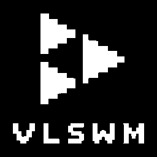

# vlswmplayer

English | [Русский](README.ru.md)

Hi, I'm **Vlad175cm**. This is my personal music player, written for the desktop
I actually use — [VLSWM](https://github.com/Vlad175cm/VLSWM), a minimal
black-and-white Wayland shell.

It plays SoundCloud without an account: type a query, press Enter, listen.
The interface is deliberately boring: only black and white, only square
corners, one monospace font. It should look like part of the shell, not like
a separate app on top of it.



## What it does

- **Search** SoundCloud tracks without logging in, through the same public
  `api-v2` endpoint the web player uses.
- **Streams instantly** — the resolved HLS stream goes straight to `mpv`,
  no download before playback.
- **Caches what you play.** First play streams and downloads in the
  background; every next play starts from disk in well under a second.
- **Likes** — a local JSON list, a separate `LIKES` tab, `*` marker on rows.
- **Follows the shell theme.** Reads the file VLSWM writes on `SUPER+T`, so the
  player flips between black and white together with the rest of the desktop.
- **Keyboard first**, mouse optional.

## Screens

Search results, the likes tab and the now-playing panel. Everything is drawn
with 1 px lines on a pure black or pure white background.

## Requirements

- Arch Linux (or an Arch-based distribution) on Wayland
- `mpv` — the playback engine
- `fuse2` — to run the AppImage

`yt-dlp` is bundled inside the AppImage, no separate installation needed.
JetBrainsMono Nerd Font is bundled too.

## Install

Download `vlswmplayer-1.0.0-x86_64.AppImage` from
[Releases](https://github.com/Vlad175cm/vlswmplayer/releases), then:

```bash
chmod +x vlswmplayer-1.0.0-x86_64.AppImage
./vlswmplayer-1.0.0-x86_64.AppImage
```

If FUSE is not available:

```bash
./vlswmplayer-1.0.0-x86_64.AppImage --appimage-extract-and-run
```

To add it to the VLSWM launcher (`SUPER+D`), build it yourself and run:

```bash
bash scripts/build-appimage.sh
bash scripts/install-desktop.sh
```

## Controls

| Key | Action |
| --- | --- |
| `SPACE` | play / pause |
| `←` / `→` | previous / next track |
| `SHIFT+←` / `SHIFT+→` | seek ∓5 s |
| `↑` / `↓` | volume ±5 |
| `TAB` | switch `SEARCH` / `LIKES` |
| `F` | like or unlike the selected track |
| `CTRL+SHIFT+C` | clear the track cache |
| `/` | focus the search field |
| `ENTER` | play the selected track |
| `Q` | quit |

Rows are clickable, progress and volume bars are draggable, the mouse wheel
scrolls the list.

## Files

| Path | Contents |
| --- | --- |
| `~/.config/vlswmplayer/config` | volume, last query, UI scale |
| `~/.config/vlswmplayer/likes.json` | liked tracks |
| `~/.cache/vlswmplayer/tracks/` | cached audio, one file per track |

Config example:

```ini
volume = 70
last_query =
scale = 0.85
```

## How it works

- Search: `GET https://api-v2.soundcloud.com/search/tracks` using the
  `client_id` that `yt-dlp` keeps in its cache. If the id goes stale, the
  player falls back to `yt-dlp scsearch10` and refreshes the cache.
- Playback: the track's `media.transcodings` entry is resolved into a direct
  HLS URL and handed to `mpv` over its JSON IPC socket. Encrypted
  (`*-encrypted-hls`) tracks are filtered out.
- State: mpv pushes `time-pos`, `duration`, `pause` and `idle-active` as
  property changes; the UI only reads them.
- Cache: `yt-dlp` downloads the same track into `~/.cache/vlswmplayer/tracks`
  while it plays, so the next start needs no network.

## Build from source

```bash
cargo build --release
bash scripts/build-appimage.sh
```

The script downloads `yt-dlp` and `appimagetool`, packs the binary, the font,
the icon and the `.desktop` file, and writes
`vlswmplayer-<version>-x86_64.AppImage` next to the sources.

## Notes

- SoundCloud's public endpoints are not an official API. They can change, and
  the `client_id` can expire; the `yt-dlp` fallback exists for that reason.
- The player does not touch your SoundCloud account: no login, no likes
  written back to the service.
- Tracks protected by DRM are skipped.

## License

[MIT](LICENSE). The bundled JetBrains Mono font is licensed under the
[SIL Open Font License 1.1](assets/JetBrainsMono-OFL.txt).
