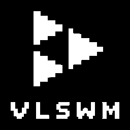

# vlswmplayer

[English](README.md) | Русский

Привет, я **Vlad175cm**. Это мой музыкальный плеер для той системы, которой я
реально пользуюсь — [VLSWM](https://github.com/Vlad175cm/VLSWM), минимального
чёрно-белого шелла на Wayland.

Он играет SoundCloud без аккаунта: ввёл запрос, нажал Enter, слушаешь.
Интерфейс нарочно скучный: только чёрный и белый, только прямые углы, один
моноширинный шрифт. Он должен выглядеть частью оболочки, а не отдельным окном
поверх неё.



## Что умеет

- **Поиск** по SoundCloud без входа, через тот же публичный `api-v2`, которым
  пользуется веб-плеер.
- **Играет сразу** — найденный HLS-поток уходит прямо в `mpv`, без ожидания
  полной загрузки.
- **Кеширует прослушанное.** Первый раз трек играет и качается в фоне; каждый
  следующий запуск идёт с диска заметно быстрее секунды.
- **Лайки** — локальный JSON, отдельная вкладка `LIKES`, метка `*` в строках.
- **Следует теме оболочки.** Читает файл, который VLSWM пишет по `SUPER+T`,
  поэтому плеер переключается между чёрным и белым вместе со всем рабочим столом.
- **Сначала клавиатура**, мышь — по желанию.

## Требования

- Arch Linux (или дистрибутив на его основе) на Wayland
- `mpv` — движок воспроизведения
- `fuse2` — чтобы запустить AppImage

`yt-dlp` вшит внутрь AppImage, отдельно ставить не нужно. Шрифт
JetBrainsMono Nerd Font тоже вшит.

## Установка

```bash
git clone https://github.com/Vlad175cm/vlswmplayer.git
cd vlswmplayer
./install.sh
```

`install.sh` скачивает последний релиз и раскладывает всё по местам:

- `~/.local/bin/vlswmplayer` — сам AppImage, уже исполняемый
- `~/.local/share/applications/vlswmplayer.desktop` — виден в rofi, wofi,
  quickshell и любом другом лаунчере, который читает `.desktop`
- `~/.local/share/icons/hicolor/256x256/apps/vlswmplayer.png`

Если файл уже скачан, можно указать его:
`./install.sh ~/Downloads/vlswmplayer-1.0.0-x86_64.AppImage`.
Файл, найденный рядом с исходниками, **переносится**, поэтому двух
одинаковых AppImage не остаётся; явно указанный файл копируется.

### Обновление

```bash
cd vlswmplayer
./update.sh
```

Скрипт забирает свежий релиз с GitHub и заменяет бинарник, ярлык и иконку.
Лайки (`~/.config/vlswmplayer`) и кеш треков (`~/.cache/vlswmplayer`) не
трогаются.

### Запуск без установки

```bash
chmod +x vlswmplayer-1.0.0-x86_64.AppImage
./vlswmplayer-1.0.0-x86_64.AppImage
```

Если FUSE недоступен:

```bash
./vlswmplayer-1.0.0-x86_64.AppImage --appimage-extract-and-run
```

## Управление

| Клавиша | Действие |
| --- | --- |
| `SPACE` | play / pause |
| `←` / `→` | предыдущий / следующий трек |
| `SHIFT+←` / `SHIFT+→` | перемотка ∓5 с |
| `↑` / `↓` | громкость ±5 |
| `TAB` | переключить `SEARCH` / `LIKES` |
| `F` | поставить или снять лайк у выбранной строки |
| `CTRL+SHIFT+C` | очистить кеш треков |
| `/` | перейти к полю поиска |
| `ENTER` | играть выбранный трек |
| `Q` | выход |

Строки кликабельны, полосы прогресса и громкости перетаскиваются, колесо мыши
листает список.

## Файлы

| Путь | Что внутри |
| --- | --- |
| `~/.config/vlswmplayer/config` | громкость, последний запрос, масштаб |
| `~/.config/vlswmplayer/likes.json` | лайкнутые треки |
| `~/.cache/vlswmplayer/tracks/` | кеш аудио, один файл на трек |

Пример конфига:

```ini
volume = 70
last_query =
scale = 0.85
```

## Как это работает

- Поиск: `GET https://api-v2.soundcloud.com/search/tracks` с `client_id`,
  который `yt-dlp` держит в своём кеше. Если идентификатор протух, плеер
  откатывается на `yt-dlp scsearch10` и обновляет кеш.
- Воспроизведение: запись из `media.transcodings` резолвится в прямой HLS-URL
  и отдаётся `mpv` через его JSON IPC. Зашифрованные (`*-encrypted-hls`) треки
  отфильтровываются.
- Состояние: mpv сам присылает `time-pos`, `duration`, `pause` и `idle-active`
  как изменения свойств, интерфейс их только читает.
- Кеш: `yt-dlp` качает тот же трек в `~/.cache/vlswmplayer/tracks`, пока он
  играет, поэтому следующий запуск не требует сети.

## Сборка из исходников

```bash
cargo build --release
bash scripts/build-appimage.sh
```

Скрипт скачивает `yt-dlp` и `appimagetool`, упаковывает бинарник, шрифт,
иконку и `.desktop`, и кладёт `vlswmplayer-<версия>-x86_64.AppImage` рядом
с исходниками.

## Замечания

- Публичные эндпоинты SoundCloud — не официальное API. Они могут меняться, а
  `client_id` — протухать; для этого и нужен откат на `yt-dlp`.
- Плеер не трогает твой аккаунт SoundCloud: нет входа, лайки никуда не
  отправляются.
- Треки под DRM пропускаются.

## Лицензия

[MIT](LICENSE). Вшитый шрифт JetBrains Mono распространяется по
[SIL Open Font License 1.1](assets/JetBrainsMono-OFL.txt).
